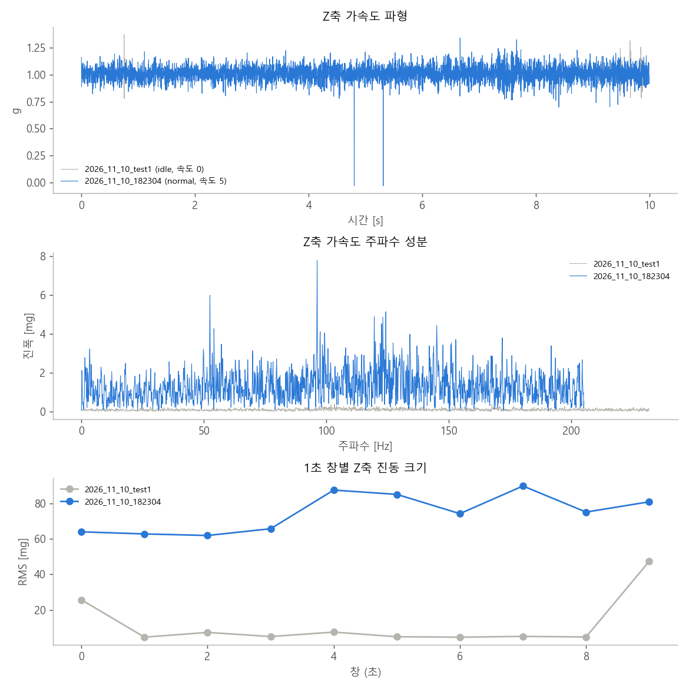

# 결과 보고서 (2026-11-10)

오늘 한 일:
1. 새 기록 형식을 읽도록 코드를 고침
2. 실측 데이터를 GitHub에 올림
3. 실측 기록으로 실험함
4. 가벼운 가상 학습·시험을 돌림

> **한 줄 요약:** 센서는 정지와 주행의 차이에 분명히 반응합니다. 하지만 실측 기록이 10초짜리 2개뿐이고 각속도가 없어서, **실측 데이터로 AI를 학습·평가하지는 못했습니다.**
> 가상 학습 결과는 코드 점검용이며 성능이 아닙니다.

## 1. 새 기록 형식 지원 (코드 수정)

팀원 스케치 형식(`t_us, ax, ay, az, mV, mA, spd, label`)과 앞으로 쓸 형식(시간, 가속도·각속도 6축, 엔코더 4개, 모터 명령, 전류, 전압)을 그대로 읽게 했습니다.

| 들어오는 값 | 바꾸는 방법 |
|---|---|
| `t_us` (마이크로초), `t_ms`, 또는 ms·µs로 적힌 `time` | 초로 바꿈. micros()가 2^32에서 0으로 돌아가도 이어 붙임 |
| 가속도·각속도 원래 정수값 | ÷8192 (g), ÷65.5 (°/s). 값은 `config.py`에서 바꿀 수 있음 |
| `mV`, `mA` | V, A로 바꿈 |
| 전류·전압이 모두 0 | 센서를 못 읽은 것으로 보고 쓰지 않음 |
| `label`의 `idle`·`stop` | 정상으로 읽음 |
| 엔코더·모터 명령·`spd` | 아직 모델에 넣지 않고 "쓰지 않은 열"로 알림 |

**확인한 것:**
- 새 형식으로 바꾼 가상 파일이 원래 파일과 같은 창, 같은 특징을 냈습니다.
- 차이가 난 곳은 420창 중 8창뿐이고, µs 반올림 때문에 경계 샘플 1개가 옮겨 간 것입니다.
- `time` 열이 밀리초인 파일도 알아서 초로 바꿨습니다.
- 기존 형식의 결과는 고치기 전과 한 글자도 다르지 않았습니다.

## 2. 실측 데이터 GitHub 업로드

| 파일 | 내용 |
|---|---|
| `data/2026_11_10_test1.csv` | 정지(`idle`, 속도 0), 10초. 웹에서 직접 올린 것 |
| `data/2026_11_10_182304.csv` | 주행(`normal`, 속도 5), 10초. 원래 이름은 `vib_normal_s5_181055.csv` |

## 3. 실측 실험: 정지 vs 주행 (`실측점검/check_recordings.py`)

AI 학습이 아니라, 파이프라인과 같은 방법으로 진동 특징을 계산해 **센서가 반응하는지** 비교했습니다.

| 항목 | 정지 (test1) | 주행 속도 5 (182304) |
|---|---|---|
| 길이, 샘플링 | 10초, 464 Hz | 10초, **410 Hz** |
| 중력 확인 | 1.02 g ✅ | 1.02 g ✅ |
| 진동 크기 X / Y / Z (mg) | 9.4 / 7.5 / 11.7 | 50.2 / 25.0 / 74.6 (**3~6배**) |
| 주파수 대역 에너지 | — | 저·중·고 모두 **3~8배** |
| 전압, 전류 | 0 (INA219 못 읽음) | **8.20 V, 0.43 A** (0.29~0.54 A) ✅ |
| 각속도 | 없음 | 없음 |



**발견한 점:**
1. **센서가 상태 변화에 분명히 반응합니다.** 진동과 전류 모두 주행에서 확실히 커졌습니다.
2. **INA219는 두 번째 기록부터 동작합니다.**
3. **Z축이 샘플 하나만 튀는 값이 2번 있습니다** (-258, 4.8초와 5.3초). I2C 읽기 오류로 보입니다. 배선과 I2C 속도를 확인해야 합니다.
4. **모터를 켜면 샘플링이 464 Hz에서 410 Hz로 떨어집니다.** 목표 500 Hz에는 못 미칩니다.
5. **정지 기록의 처음과 끝 1초가 흔들립니다.** 기록을 시작하고 멈출 때 로봇을 건드린 것으로 보입니다.

자세한 표: [실측_결과/2026-11-10/README.md](실측_결과/2026-11-10/README.md)

## 4. 가벼운 가상 학습·시험 (코드 점검용 · 성능 아님)

지난번 학습(160대, 35분)을 4분의 1 규모로 줄여 돌렸습니다: `test_complex.py --scale 0.25`

| | 가벼운 학습 (오늘) | 전체 학습 (11/10 새벽) |
|---|---|---|
| 학습 로봇, 기록 분량 | 40대, 10.7시간 | 160대, 42.6시간 |
| 학습 시간 | **1.7분** | 35.2분 |
| 시험 로봇 | 45대 | 170대 |
| **전체 판정 정답률** | **82.2%** | 87.1% |
| 일반 로봇 | 88% | 92% |
| 복잡한 고장 | 64.3% | 72% |
| 헷갈리기 쉬운 정상 (오경보) | 100% (0%) | 100% (0%) |
| 오토인코더 AUC | 0.779 | 0.800 |
| 남은 시간 오차 | 0.9분 | 1.0분 |

- 학습을 4분의 1로 줄이자 정답률이 약 5%p 떨어졌지만, 학습 시간은 20분의 1이 됐습니다.
- 두 시험은 시험 로봇 수가 달라서 대략적인 비교입니다.
- 약점은 똑같습니다. 간헐 고장(0/2), 약한 고장(0/2), 뒤 바퀴 체결부 풀림을 놓쳤습니다.
- 자세한 결과: [가상데이터_결과값/복잡한고장_가볍게/README.md](가상데이터_결과값/복잡한고장_가볍게/README.md)

## 5. 실측 학습을 하려면 (내일 모델 마감 전에 할 일)

| 할 일 | 이유 |
|---|---|
| **한 기록을 6분 이상** (처음 5분은 주행·정지·회전을 섞어서) | 처음 5분이 그 로봇의 정상 기준 |
| **각속도 gx, gy, gz 추가** (새 스케치) | 지금 코드는 6축이 모두 있어야 학습함 |
| 정상 기록 3개 이상, 고장 종류마다 2개 이상 | 교차검증과 원인 분류에 필요 |
| 같은 기록이면 같은 `robot` 열 | `robot` 열이 없으면 파일 이름이 로봇 이름이 됨 |
| Z축 튀는 값 확인 (배선, I2C) | 오경보의 원인이 될 수 있음 |
| 스케치의 센서 범위 확인 (±4g, ±500°/s) | 다르면 `config.RAW_ACCEL_LSB_PER_G`, `RAW_GYRO_LSB_PER_DPS`를 고침 |

이 조건을 맞춘 CSV를 `data/`에 넣고 아래를 실행하면 실측 성능(교차검증)이 나옵니다.

```
python run.py check
python run.py train
```
