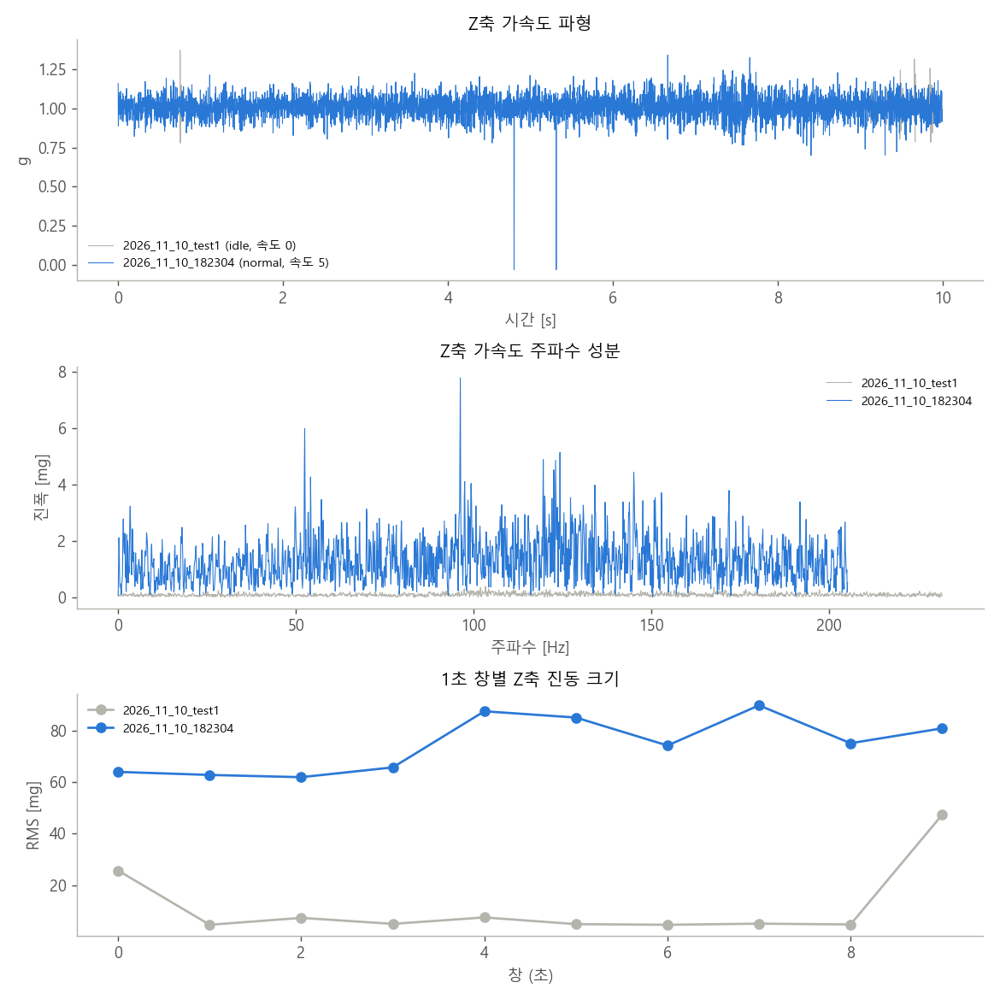

# 실측 기록 점검 (2026-11-10 18:26)

> **AI 학습·성능 결과가 아닙니다.** 기록이 짧고(10초) 각속도가 없어 학습할 수 없으므로,
> 파이프라인과 같은 방법으로 진동 특징을 계산해 **센서가 상태 변화에 반응하는지**만 비교했습니다.

## 기록 품질

| 파일 | 라벨 | 속도 단계 | 길이(초) | 샘플링(Hz) | 빠진 구간(간격 2배 넘음) | 가속도 크기 평균(g) | 각속도 열 | 전압(V) | 전류(A) | 확인할 점 |
|---|---|---|---|---|---|---|---|---|---|---|
| 2026_11_10_test1.csv | idle | 0 | 10.0 | 463.8 | 0 | 1.02 | 없음 | 없음(0) | 없음(0) | t_us 열을 time[s]로 바꿔 읽었습니다 (× 1e-06). / mv 열을 voltage[V]로 바꿔 읽었습니다 (× 0.001). / ma 열을 current[A]로 바꿔 읽었습니다 (× 0.001). / 가속도가 센서 원래값이라 가속도 ÷8192(g)로 바꿨습니다. 스케치의 센서 범위 설정이 다르면 config.RAW_ACCEL_LSB_PER_G·RAW_GYRO_LSB_PER_DPS를 고치세요. / 2026_11_10_test1.csv: current 값이 모두 0이라 INA219를 읽지 못한 것으로 보고 쓰지 않습니다 (배선·주소 0x40 확인). / 2026_11_10_test1.csv: voltage 값이 모두 0이라 INA219를 읽지 못한 것으로 보고 쓰지 않습니다 (배선·주소 0x40 확인). / 쓰지 않은 열: spd (엔코더·모터 명령 등은 아직 모델에 넣지 않음) |
| 2026_11_10_182304.csv | normal | 5 | 10.0 | 410.5 | 0 | 1.018 | 없음 | 8.20 (8.18~8.22) | 0.429 (0.289~0.535) | t_us 열을 time[s]로 바꿔 읽었습니다 (× 1e-06). / mv 열을 voltage[V]로 바꿔 읽었습니다 (× 0.001). / ma 열을 current[A]로 바꿔 읽었습니다 (× 0.001). / 가속도가 센서 원래값이라 가속도 ÷8192(g)로 바꿨습니다. 스케치의 센서 범위 설정이 다르면 config.RAW_ACCEL_LSB_PER_G·RAW_GYRO_LSB_PER_DPS를 고치세요. / 쓰지 않은 열: spd (엔코더·모터 명령 등은 아직 모델에 넣지 않음) |

## 진동 특징 (1초 창 평균 ± 표준편차)

| 축 | 특징 | 2026_11_10_test1 | 2026_11_10_182304 | 배율 (2026_11_10_182304 ÷ 2026_11_10_test1) |
|---|---|---|---|---|
| ax | 진동 크기 RMS [mg] | 9.37 ± 7.3 | 50.2 ± 7.7 | 5.4배 |
| ax | 첨도 | 13.3 ± 21 | 3.6 ± 0.51 | 0.27배 |
| ax | 크레스트 | 5.24 ± 2.9 | 3.77 ± 0.58 | 0.72배 |
| ax | 저주파 1~20 Hz | 0.0163 ± 0.011 | 0.0571 ± 0.01 | 3.5배 |
| ax | 중주파 20~150 Hz | 0.0917 ± 0.065 | 0.522 ± 0.079 | 5.7배 |
| ax | 고주파 150 Hz~ | 0.0658 ± 0.063 | 0.283 ± 0.051 | 4.3배 |
| ay | 진동 크기 RMS [mg] | 7.53 ± 10 | 25 ± 3 | 3.3배 |
| ay | 첨도 | 5.45 ± 4.9 | 3.41 ± 0.58 | 0.63배 |
| ay | 크레스트 | 4.29 ± 1.5 | 3.49 ± 0.49 | 0.81배 |
| ay | 저주파 1~20 Hz | 0.0112 ± 0.011 | 0.039 ± 0.0078 | 3.5배 |
| ay | 중주파 20~150 Hz | 0.0757 ± 0.096 | 0.285 ± 0.037 | 3.8배 |
| ay | 고주파 150 Hz~ | 0.034 ± 0.031 | 0.0941 ± 0.013 | 2.8배 |
| az | 진동 크기 RMS [mg] | 11.7 ± 14 | 74.6 ± 11 | 6.4배 |
| az | 첨도 | 18.9 ± 30 | 13.2 ± 21 | 0.7배 |
| az | 크레스트 | 5.96 ± 3.8 | 5.27 ± 3.6 | 0.89배 |
| az | 저주파 1~20 Hz | 0.0113 ± 0.012 | 0.0865 ± 0.024 | 7.7배 |
| az | 중주파 20~150 Hz | 0.111 ± 0.12 | 0.861 ± 0.13 | 7.8배 |
| az | 고주파 150 Hz~ | 0.092 ± 0.12 | 0.333 ± 0.052 | 3.6배 |

1초 창 수: 2026_11_10_test1 10개, 2026_11_10_182304 10개

## 해석

1. **센서가 상태 변화에 분명히 반응합니다.**
   - 모터를 켜고 속도 5로 달리자 진동 크기(RMS)가 축마다 3~6배 커졌습니다 (Z축 11.7 → 74.6 mg).
   - 저·중·고주파 에너지도 모두 3~8배 커졌습니다.
2. **INA219가 두 번째 기록부터 동작합니다.**
   - 전압 8.20 V (2S 리포 거의 만충), 전류 평균 0.43 A (0.29~0.54 A)가 찍혔습니다.
   - 첫 기록(정지)은 전류·전압이 모두 0이라 쓰지 않았습니다.
3. **주행 기록에 튀는 값이 2번 있습니다.**
   - 4.8초와 5.3초에 Z축 가속도가 샘플 하나만 정확히 같은 값(-258, 약 -0.03 g)으로 떨어졌습니다.
   - 실제 진동이 아니라 I2C 읽기 오류로 보입니다. 이 때문에 Z축 첨도가 13.2 ± 21로 크게 흔들렸습니다.
   - 배선(SDA·SCL 길이, 접촉)과 I2C 속도를 확인하세요. 계속 나오면 이런 값을 걸러 내는 처리를 넣어야 합니다.
4. **정지 기록의 처음과 끝 1초가 흔들립니다** (Z축 25 mg, 47 mg). 기록을 시작하고 멈출 때 로봇을 건드린 것으로 보입니다.
5. **모터를 켜면 샘플링이 464 Hz에서 410 Hz로 떨어집니다.**
   - 아두이노가 모터 제어와 기록을 같이 하느라 느려진 것으로 보입니다.
   - 300 Hz 위라 고주파 특징은 쓸 수 있지만, 목표 500 Hz에는 못 미칩니다.

## 학습하려면 필요한 것

| 필요한 것 | 지금 |
|---|---|
| 한 기록 6분 이상 (처음 5분 = 정상 기준) | 10초 |
| 각속도 gx, gy, gz | 없음 (새 스케치에 추가 예정) |
| 정상 기록 3개 이상, 고장 종류마다 2개 이상 | 정상 주행 1개 |
| 같은 기록은 같은 `robot` 이름 | 없음 (파일 이름이 로봇 이름이 됨) |
