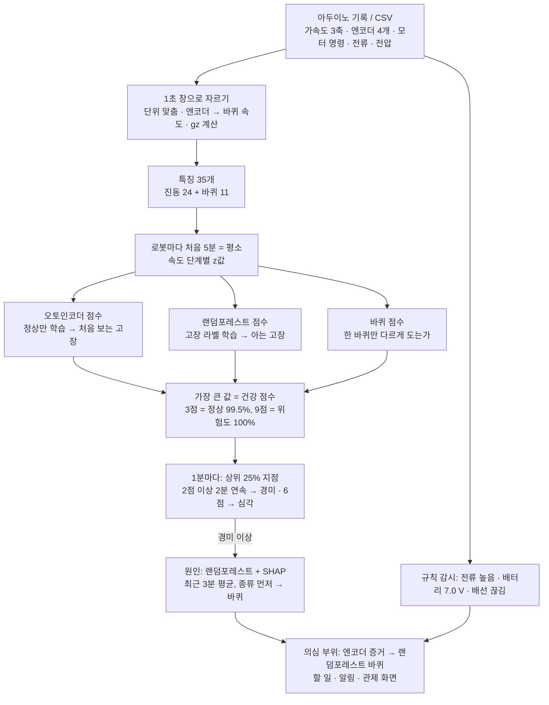

# 최종 결과 (2026-11-19) — AMR 구동계 고장 예지 AI

> **이 문서의 성능은 '실측 데이터 + 실측으로 보정한 가상 데이터'로 잰 값입니다.** 실측 고장 기록이 테이프 불균형 20초짜리 몇 개뿐이라
> 모든 고장·센서를 실측으로 잴 수 없어서(대회 측도 인정), 실측을 바탕으로 가상 데이터를 만들어 보완했습니다. 순수 실측 성능이 아닙니다.

## 1. 한눈에 보기

| 항목 | 결과 (처음 보는 시험 로봇, 실제 진단 코드 `workflow.diagnose`) |
|---|---|
| **판정 정답률 (기본 조건 L0, 82대)** | **97.6%** (고장은 경보, 정상은 경보 없음이면 맞음) |
| 고장 감지율 | **95.3%** (43대 중 41대) |
| 정상 오경보율 | **0%** (39대 중 0대) |
| 원인(고장 종류) 맞음 | 90.2% (원인을 낸 41대 중 37대) |
| 검증 로봇 (설정을 고른 로봇 183대) | 정답률 96.7%, 감지 94.2%, 오경보 0% |
| 실측 시험 로봇 2대 (학습에 안 쓴 실측 파일) | 정상 로봇 오경보 없음 ✅ · 테이프 고장 로봇은 고장 기록이 22초뿐이라 '2분 연속' 규칙을 채우지 못해 **놓침** (경미 3점·1번 설정이면 7.0분에 감지) |

**95~99%가 나오는 조건 = 기본 조건(L0)**: 아래 3절의 데이터 조건에서, 고장 세기를 줄이거나 엔코더 끊김을 넣지 않은 시험 로봇. 조건을 어렵게 하면 성능이 내려갑니다 (2절 표). 설정은 시험 로봇이 아니라 **검증 로봇으로 골랐습니다** (시험 로봇으로 고르면 숫자가 부풀려짐).

## 2. 조건별 결과 (같은 모델, 시험 로봇은 조건마다 새로 만듦 · 82대씩)

| 시험 조건 | 지금 설정 (경미 경보 2점 · 2번 연속) 정답률 / 감지 / 오경보 / 원인 | 바꾸기 전 설정 (3점 · 1번) 정답률 / 감지 |
|---|---|---|
| **L0 기본** | **97.6% / 95.3% / 0% / 90.2%** | 93.9% / 88.4% |
| L1 약한 고장 (고장 세기 × 0.6) | 93.9% / 90.4% / 0% / 100% | 75.6% / 61.5% |
| L2 L1 + 엔코더 끊김 (로봇 40%에서 바퀴 하나의 엔코더가 평균 40초마다 1~8초 멈춤) | 89.0% / 81.6% / 0% / 97.4% | 65.9% / 42.9% |
| L3 L2 + 더 약한 고장 (× 0.4) | 80.5% / 71.4% / 0% / 100% | 57.3% / 37.5% |
| L4 L3 + 처음 보는 고장 (고장 절반을 학습에 없던 베어링 주파수 120·320 Hz로) | 74.4% / 52.3% / 0% / 68.2% | 56.1% / 18.2% |

- 모든 조건에서 오경보 0% → 약한 고장·엔코더 끊김·처음 보는 고장에서 **놓치는 쪽**으로 성능이 떨어짐
- 엔코더 끊김(실측 앞 오른쪽 엔코더에서 자주 보임)이 감지를 크게 낮춤 → 실제 로봇에서는 엔코더 배선 확인이 중요
- 처음 보는 고장(L4)은 약 절반만 잡음. 테이프 불균형을 학습에서 빼고 시험했을 때도 60% (README 7-6)

## 3. 데이터 조건 (팀 결정: 모든 데이터에 고장 라벨·엔코더 4개)

| 항목 | 내용 |
|---|---|
| 실측 데이터 | 정상: 공3옥상(11.13·11.16) 속도 5·7, 욧골(11.15) 속도 5 · 고장: 욧골 앞 오른쪽 바퀴 테이프(바퀴 불균형) 속도 5. 기록기 열 = `t_us, ax, ay, az, mV, mA, spd, enc2, label` (480 Hz) |
| 실측 파일 나누기 | 파일 단위로 학습 40 · 검증 14 · 시험 19개 (겹치지 않음). 테이프 고장: 학습 `s5_171612`, 시험 `s5_172040`·`s5_172110`. 속도 7 테이프 고장은 같은 바닥 속도 7 정상이 없어 뺌 |
| 실측 로봇 (학습 2대 · 시험 2대) | 같은 날·바닥 실측 파일을 시간 순서로 이어 붙임. 앞 5.5분(정상 기준)은 그 로봇의 실측 정상 파일을 섞어 되풀이 |
| 엔코더 4개 | 앞 오른쪽 = **실측 enc2** (샘플당 펄스 × 0.1848 → 바퀴 1회전 330펄스 눈금, 끊김·0 그대로) · 나머지 3개 = 모터 명령으로 정한 바퀴 속도 + 평소 흔들림 4.5% (가상) |
| 각속도 | 실측 기록기에 없으므로 **가상 데이터에서도 뺌**. 회전 속도 gz는 좌우 엔코더로 계산 (`GYRO_FROM_ENCODERS`) |
| 가상 로봇 (학습 51대 · 검증 183대 · 시험 82대 × 5조건) | `가상테스트/실측보정_로봇.py`: 가속도·전류·전압 = 실측 정상 조각(2~6초)을 이어 붙임(로봇마다 축별 크기 ±15%), 정지 = 실측 정지 조각. 고장은 처음 6~8분 뒤 시작해 진행(점진·급성·간헐·복합·약한·속도 다름 등) |
| 가상 고장 | **바퀴 불균형 = 실측 '테이프 고장 − 정상' 진동 증가분**(바퀴 1·2·3배 회전 성분은 회전 위상에 맞춘 사인파, 나머지는 같은 주파수 모양 잡음) + 고장 바퀴 엔코더 1회전마다 ±12% 흔들림(실측 앞 오른쪽 엔코더 흔들림 2~4배와 맞음). **체결 풀림·마찰 증가는 실측이 없어** 모양은 가정(충격·200 Hz 잡음, 마찰 바퀴 15% 느려짐)이고 진동 증가 에너지만 실측 불균형과 같게 맞춤 |
| 헷갈리는 정상 | 바닥 바뀜(실측 공3옥상 → 실측 욧골 조각), 짐 실음, 저전압, 속도 바뀜 |
| 보정 확인 (가상 / 실측) | 앞뒤·위아래 흔들림: 공3옥상 정상 0.19/0.21 g · 0.54/0.55 g, 욧골 정상 0.33/0.34 · 0.85/0.89, 욧골 테이프 고장 0.57/0.56 · 1.08/1.11 |

## 4. 파라미터 (`second_model/config.py` 기본값)

| 구분 | 파라미터 | 값 | 뜻 |
|---|---|---|---|
| 창·특징 | `WINDOW_S` | 1.0 | 1초 창 |
| | 특징 수 | 35 | 진동 24 (ax·ay·az·gz × RMS·첨도·크레스트·저/중/고주파) + 바퀴 11 (바퀴별 상대 속도·속도 흔들림, 앞뒤 차이, 명령 대비 속도) |
| 정상 기준 | `BASELINE_PERIODS` | 5 | 로봇마다 처음 5분 = 평소 (속도 단계별, `SEGMENT_FROM_MOTOR_CMD`) |
| 이상 점수 | 오토인코더 | MLP 35-24-6-24-35, tanh, 400회 | 정상만 학습, 복원 오차 |
| | `RF_DETECTOR` | True | 랜덤포레스트 '정상이 아닐 확률' (150그루, 잎 최소 3, 균형 가중) |
| | `WHEEL_SCORE` | True | 바퀴 하나만 다른 정도 (엔코더 4개) |
| | 주 모델 | `ae_rf_wheel` | 오토인코더 · 랜덤포레스트 · 바퀴 점수 중 큰 값 |
| 눈금 | `THRESH` | 3 / 6 / 9 | 정상 99.5% = 3점, 심각 6점, 학습한 고장 기준(고장 정도 0.75~0.85, `FAIL_CAL_BAND`) = 9점 = 위험도 100% |
| 판정 | `PERIOD_S` | 60 | 1분마다 판정 |
| | `PERIOD_QUANTILE` | **0.75** | 1분 점수 = 그 1분 동안 1초 점수의 상위 25% 지점 |
| | `CAUTION_ALARM` | **2.0** | 1분 점수가 2점 이상이면 경미 후보 (눈금은 그대로, 11/19 추가) |
| | `CONFIRM_PERIODS` | **2** | 2번(2분) 연속이면 단계 변경 (9점 이상은 바로) |
| 원인 | `CAUSE_WINDOW` | **180** | 최근 3분 원인 확률 평균 |
| | `CAUSE_BY_KIND` | **True** | 고장 종류마다 바퀴 4개 확률을 더해 종류 먼저 (원인 맞음 94.1% → 97.4%, 11/18 시험) |
| | 원인 분류 | 랜덤포레스트 150그루 + SHAP | 종류\|바퀴 라벨, 고장 정도 0.25 이상 창으로 학습 (`CAUSE_MIN_SEVERITY`) |
| 규칙 감시 (AI 아님) | 전류·배터리·배선 | 99.5% · 7.0 V · 30%/0.2초 | 전류 높음·배터리 낮음·배선 순간 끊김 (각 2분 연속) |

**판정 설정을 고른 방법** (`가상테스트/실측혼합_조정.py`): 검증 로봇 183대(L0·L1·L2 섞음)로 '이상 점수 방법 5 × 1분 점수 지점 0.5·0.75·0.9 × 연속 1·2번 × 경미 경보 1.5·2·2.5·3점' = 120조합을 채점 → 오경보 3% 이하에서 정답률 최고 = 오토인코더·랜덤포레스트·바퀴 점수, 0.75, 2번, 2점.

## 5. 지금 모델이 구동되는 방식



1. 1초마다 특징 35개를 계산하고, 그 로봇의 처음 5분(평소)과 비교해 z값으로 바꿉니다.
2. 세 점수(오토인코더 · 랜덤포레스트 · 바퀴 점수)를 같은 눈금으로 맞춘 뒤 가장 큰 값을 건강 점수로 씁니다.
3. 1분마다 그 1분의 상위 25% 지점이 2점 이상인 주기가 2번 연속이면 **경미**, 6점 이상이면 **심각**입니다. 위험도 % = 점수 ÷ 9 × 100입니다.
4. 경미 이상이면 원인을 냅니다. 최근 3분 동안 랜덤포레스트 확률을 평균 내고, 고장 종류를 먼저 고른 다음 바퀴를 붙입니다. SHAP으로 판단 근거 3개를 보여 줍니다.
5. 전류·배터리·배선은 AI와 따로 규칙으로 감시합니다.

## 6. 한계

- **실측 성능이 아님**: 실측 고장은 테이프 불균형 하나, 20초씩 3개뿐. 체결 풀림·마찰 증가의 모양은 가정
- 실측 테이프 고장 시험 로봇은 고장 기록이 22초라 지금 설정('2분 연속')으로는 판정이 안 됨 → **고장 상태로 2~3분 이상 이어서 기록**하면 확인 가능
- 실측 테이프 고장은 진동이 거친 바닥과 비슷하게 커져서(고장 1.2~1.7배, 바닥 바뀜 1.6~1.9배), 학습에 없을 때는 오토인코더가 잘 못 잡음. 바퀴 회전 박자(1·2·3배) 특징을 추가하면 나아질 수 있음
- 나머지 3개 엔코더와 회전 속도 gz는 가상. 실제 엔코더 4개를 달면 다시 학습·시험해야 함
- 시험 로봇 82대 기준이라 1대가 약 1.2%p

## 7. 다시 돌리기 (`second_model` 폴더, 실측 폴더는 GitHub에 없음)

```bash
python 가상테스트/실측혼합_시험.py --g3 "정상 데이터_공3옥상" --g3 "정상 데이터_공3옥상(11.16)" --yg "정상 데이터_욧골(11.15)" --fault "고장 데이터_욧골" --jobs 8
```

```bash
python 가상테스트/실측혼합_조정.py --g3 "정상 데이터_공3옥상" --g3 "정상 데이터_공3옥상(11.16)" --yg "정상 데이터_욧골(11.15)" --fault "고장 데이터_욧골" --jobs 8
```

첫 번째가 학습(가상 51대 + 실측 2대)과 조건별 시험, 두 번째가 저장된 모델로 검증 로봇 설정 고르기와 시험입니다(각 약 40분). 결과는 `가상테스트_결과/실측혼합*/` (GitHub에 없음). 바꾼 내용의 자세한 기록은 [second_model/README.md](second_model/README.md) 7-5 ~ 7-7.
