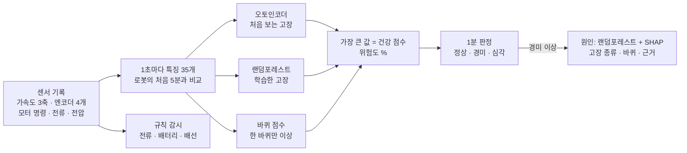

# AMR 구동계 고장 예지 AI — 최종 코드와 결과 (2026-11-19)

배송로봇(AMR) 바퀴·모터 쪽 고장을 **진동 + 엔코더**로 미리 알아채고, **무슨 고장이 어느 바퀴에** 났는지와 **위험도(%)**를 알려 줍니다.

> 성능은 **실측 데이터 + 실측으로 보정한 가상 데이터**로 잰 값입니다(순수 실측 성능 아님). 실측 고장 기록이 적어 모든 고장을 실측할 수 없어서 가상 데이터로 보완했습니다.
>
> **이 폴더(`final/`)에 프로젝트에 필요한 코드가 모두 들어 있습니다.** 개발 기록과 그 밖의 실험은 [`../second_model/`](../second_model/README.md)에 있습니다.

## 1. 모델 구조



| 역할 | 모델 | 학습 | 하는 일 |
|---|---|---|---|
| 고장 알아채기 ① | **오토인코더** (신경망 35-24-6-24-35) | 정상 데이터만 (비지도) | 평소와 다른 진동 → **처음 보는 고장**도 잡음 |
| 고장 알아채기 ② | **랜덤포레스트** (150그루) | 정상 + 고장 라벨 (지도) | '정상이 아닐 확률' → **학습한 고장**을 빠르고 정확하게 |
| 고장 알아채기 ③ | **바퀴 점수** (계산 규칙) | 없음 | 엔코더 4개 중 **한 바퀴만 다르게 도는 정도** |
| 원인 찾기 | **랜덤포레스트 + SHAP** (150그루) | 고장 라벨 (지도) | 바퀴 불균형 · 체결 풀림 · 마찰 증가 + 바퀴 위치, 판단 근거 3개 |
| 따로 감시 | 규칙 (AI 아님) | 없음 | 전류 높음 · 배터리 7.0 V 아래 · 배선 순간 끊김 |

- 세 점수를 같은 눈금으로 맞춥니다: 정상 상위 0.5% = 3점, 학습한 고장 기준 = 9점(위험도 100%). 그중 **가장 큰 값**이 건강 점수입니다.
- 1분마다 그 1분의 상위 25% 점수가 **2점 이상인 상태가 2분 연속**이면 **경미**, 6점 이상이면 **심각**입니다.
- 원인은 최근 3분 동안의 확률로 **고장 종류를 먼저** 정한 뒤, 가장 의심되는 바퀴를 붙입니다.

## 2. 데이터

| 구분 | 내용 |
|---|---|
| 실측 | 정상: 공3옥상(11.13 · 11.16, 속도 5 · 7), 욧골(11.15, 속도 5). 고장: 욧골 **앞 오른쪽 바퀴 테이프**(바퀴 불균형). 480 Hz |
| 보완 (가상) | 실측 엔코더는 앞 오른쪽 하나뿐 → **나머지 3개를 가상으로 채움**. 가상 로봇은 실측 정상 조각을 이어 붙여 만들고, 테이프 고장은 **실측에서 잰 진동 증가분**을 그대로 넣음. 실측에 없는 체결 풀림 · 마찰 증가는 가정으로 만듦 |
| 가정 | 모든 데이터에 고장 라벨 · 엔코더 4개가 있음. 각속도는 실제 기록기처럼 쓰지 않음 |
| 나누기 | 실측 파일을 학습 · 검증 · 시험으로 나눠 겹치지 않게 함. 판정 설정은 **검증 로봇**으로 고르고, 성능은 **처음 보는 시험 로봇**으로 잼 |

## 3. 최종 성능 (처음 보는 시험 로봇)

| 시험 조건 | 판정 정답률 | 고장 감지 | 오경보 | 원인 맞음 |
|---|---|---|---|---|
| **기본 (82대: 고장 43 · 정상 39)** | **97.6%** | **95.3%** | **0%** | 90.2% |
| 약한 고장 (세기 × 0.6) | 93.9% | 90.4% | 0% | 100% |
| 약한 고장 + 엔코더 끊김 | 89.0% | 81.6% | 0% | 97.4% |

- 정상 로봇에서는 어느 조건에서도 **오경보가 없었습니다.**
- 실측 시험 로봇: 정상 로봇은 오경보가 없었습니다. 테이프 고장 로봇은 고장 기록이 22초뿐이라 '2분 연속' 판정을 하지 못했습니다.

## 4. 핵심 설정값 (`second_model/config.py`)

| 설정 | 값 | 뜻 |
|---|---|---|
| `RF_DETECTOR` | True | 오토인코더 · 랜덤포레스트 · 바퀴 점수 중 큰 값으로 판정 |
| `PERIOD_QUANTILE` | 0.75 | 1분 점수 = 1초 점수의 상위 25% 지점 |
| `CAUTION_ALARM` | 2.0 | 경미 경보 문턱 (점수 눈금은 그대로) |
| `CONFIRM_PERIODS` | 2 | 2분 연속이면 단계 변경 |
| `CAUSE_WINDOW` · `CAUSE_BY_KIND` | 180 · True | 원인 = 최근 3분 평균, 고장 종류를 먼저 고름 |
| `BASELINE_PERIODS` | 5 | 로봇마다 처음 5분 = 평소 |

## 5. 폴더 구성과 실행 방법

| 폴더·파일 | 내용 |
|---|---|
| `config.py` | 모든 설정값 (4절) |
| `run.py` | 명령 입구: `check`(데이터 검사) · `train`(학습 + 교차검증) · `diagnose`(로봇별 진단) · `live`(실시간 알림·관제 화면) |
| `pipeline/` | 모델 본체: 읽기(`dataio`) → 특징(`features`) → 모델(`models`) → 학습(`system`·`workflow`) → 판정·원인(`infer`) → 전류·배터리·배선 감시(`power`) → 화면·보고서(`live`·`report`), 아두이노 연결(`arduino`) |
| `실행/` | VS Code·더블클릭용: `1_환경설치` → `2_데이터_검사` → `3_학습_평가` → `4_진단`, `0_아두이노_기록` |
| `가상테스트/` | 최종 시험: `실측보정_로봇.py`(실측으로 보정한 가상 로봇 생성기) · `실측혼합_시험.py`(실측 + 가상 학습, 조건별 시험) · `실측혼합_조정.py`(검증 로봇으로 판정 설정 고르기 + 시험). 나머지(`sim_robots`·`test_complex`·`compare_ae_rf`·`실측보정_시험`·`실측보정_난이도`)는 이 셋이 쓰는 부품과 실시간 시연(`live --demo`)용 |
| `arduino/` | 센서 연결 안내, 기록 스케치(`amr_logger`), 모터·엔코더 점검 스케치. 팀 기록 스케치(`team_logger`)는 GitHub에 올리지 않음 |
| `data/` | 실측 CSV를 넣는 곳 (GitHub에 안 올라감) |

**처음 한 번:** `python 실행/1_환경설치.py` (또는 VS Code `실행 및 디버그` → `1. 환경 설치`)

**실측 기록으로 학습·진단:** CSV를 `data/`에 넣고

```bash
python run.py check
```

```bash
python run.py train
```

```bash
python run.py diagnose
```

**실시간 알림·관제 화면:** 아두이노를 USB로 연결하고 `python run.py live` (로봇 없이 시연: `python run.py live --demo`)

**최종 시험 다시 돌리기:** 실측 폴더 4개를 `data/` 아래에 두고 (각 약 40분)

```bash
python 가상테스트/실측혼합_시험.py --g3 "data/정상 데이터_공3옥상" --g3 "data/정상 데이터_공3옥상(11.16)" --yg "data/정상 데이터_욧골(11.15)" --fault "data/고장 데이터_욧골" --jobs 8
```

```bash
python 가상테스트/실측혼합_조정.py --g3 "data/정상 데이터_공3옥상" --g3 "data/정상 데이터_공3옥상(11.16)" --yg "data/정상 데이터_욧골(11.15)" --fault "data/고장 데이터_욧골" --jobs 8
```

VS Code에서는 `final` 폴더를 열고 `실행 및 디버그` 목록의 `최종 시험 1 → 2`를 누르면 됩니다. 결과는 `가상테스트_결과/` (GitHub에 안 올라감).

## 6. 한계와 다음 할 일

- 실측 고장은 **테이프 불균형 하나**입니다. 체결 풀림 · 마찰 증가는 실측 기록이 필요합니다.
- 고장 상태로 **2~3분 이상 이어서** 기록해야 실측으로 판정을 확인할 수 있습니다.
- 학습에 없는 고장은 절반 정도만 잡습니다. 테이프 고장의 진동이 거친 바닥과 비슷하기 때문입니다. 바퀴 회전 박자 특징을 추가하면 나아질 수 있습니다.
- 엔코더 4개를 실제로 달면 다시 학습 · 시험해야 합니다.

## 7. 관련 논문

우리와 구성이 똑같은 논문은 찾지 못했고, 일부가 겹치는 논문들입니다. ★ = 본문 확인, 나머지는 검색 요약 기준이라 인용 전 원문 확인이 필요합니다.

**비슷한 로봇 · 비슷한 방법**
1. ★ Pookkuttath S. 외, "AI-Enabled Predictive Maintenance Framework for Autonomous Mobile Cleaning Robots", *Sensors* 22(1):13, 2021. [링크](https://www.ncbi.nlm.nih.gov/pmc/articles/PMC8747287/)
   - 이동 청소 로봇에 IMU를 달고, 바퀴 연결부를 풀어 고장을 재현했습니다. 1D CNN 지도학습이라 고장 데이터가 꼭 필요합니다(우리는 오토인코더로 보완).
2. ★ Jakubowski J. 외, "Anomaly Detection in Asset Degradation Process Using Variational Autoencoder and Explanations", *Sensors* 22(1):291, 2022. [링크](https://pmc.ncbi.nlm.nih.gov/articles/PMC8749861/)
   - 오토인코더로 이상을 감지하고 랜덤포레스트 + SHAP으로 설명합니다. 우리와 방법이 가장 비슷하지만, 랜덤포레스트로 원인을 분류하지는 않습니다.
3. Low-Cost IoT-Based Predictive Maintenance Using Vibration, *PMC*, 2025. [링크](https://pmc.ncbi.nlm.nih.gov/articles/PMC12609400/)
   - 우리와 같은 MPU6050으로 두 바퀴 로봇의 진동 이상을 찾았습니다.

**지도 + 비지도를 함께 쓰는 이유 (처음 보는 고장 · 적은 고장 데이터)**

4. Novelty Detection and Fault Diagnosis Method for Bearing Faults Based on the Hybrid Deep Autoencoder Network, *Electronics* 12(13):2826, 2023. [링크](https://mdpi.com/2079-9292/12/13/2826)
   - 오토인코더로 새 고장을 거르고, 분류기로 아는 고장을 분류합니다.
5. Hybrid Deep Learning for Predictive Maintenance Using LSTM and MLP Models, *Machines* 14(2):191, 2026. [링크](https://www.mdpi.com/2075-1702/14/2/191)
   - 오토인코더로 이상을 감지하고, 다른 모델로 예측하는 2단계 구조입니다.
6. Zhang S. 외, "Semi-Supervised Learning of Bearing Anomaly Detection via Deep Variational Autoencoders", arXiv:1912.01096, 2019. [링크](https://arxiv.org/abs/1912.01096)
   - 고장 라벨이 적을 때 정상 · 라벨 없는 데이터를 활용합니다.
7. Towards Open-Set Fault Diagnosis for Reactor Coolant Pumps under Unknown Fault Conditions, *PHM Society Asia-Pacific*, 2025. [링크](https://papers.phmsociety.org/index.php/phmap/article/view/4619)
   - 지도학습만 쓰면 처음 보는 고장을 아는 고장으로 착각한다는 문제를 다룹니다.

**엔코더 · 바퀴 비교**

8. Fault Detection and Diagnosis of Three-Wheeled Omnidirectional Mobile Robot, *Mathematics* 12(11):1731, 2024. [링크](https://doi.org/10.3390/math12111731)
   - 바퀴 엔코더끼리 비교해 이상을 찾습니다(우리 바퀴 점수와 비슷).
9. Fault Tolerant Control for a 4-Wheel Skid Steering Mobile Robot, DX 2015. [링크](https://ceur-ws.org/Vol-1507/dx15paper23.pdf)
   - 4륜 스키드 로봇은 회전할 때 바퀴가 미끄러진다는 주의점과, 고장 바퀴를 추정하는 방법을 다룹니다.

**쓴 기법의 원 논문**

10. Breiman L., "Random Forests", *Machine Learning* 45:5–32, 2001. [링크](https://doi.org/10.1023/A:1010933404324)
11. Lundberg S. M., Lee S.-I., "A Unified Approach to Interpreting Model Predictions" (SHAP), *NeurIPS* 2017. [링크](https://arxiv.org/abs/1705.07874)
12. Li Z. 외, "ECOD: Unsupervised Outlier Detection Using Empirical Cumulative Distribution Functions", *IEEE TKDE*, 2022. [링크](https://arxiv.org/abs/2201.00382) — 오토인코더와 비교한 모델
13. Autoencoder-based Condition Monitoring and Anomaly Detection for Rotating Machines, arXiv:2101.11539. [링크](https://arxiv.org/abs/2101.11539)
    - 정상 진동만 학습하고 복원 오차로 판단합니다(우리 오토인코더와 같은 원리).

논문 원문 파일(PDF)은 저작권 때문에 올리지 않고 링크만 적었습니다. 시험 방법과 결과의 자세한 기록은 [second_model/README.md](../second_model/README.md) 7-5 ~ 7-7에 있습니다.
